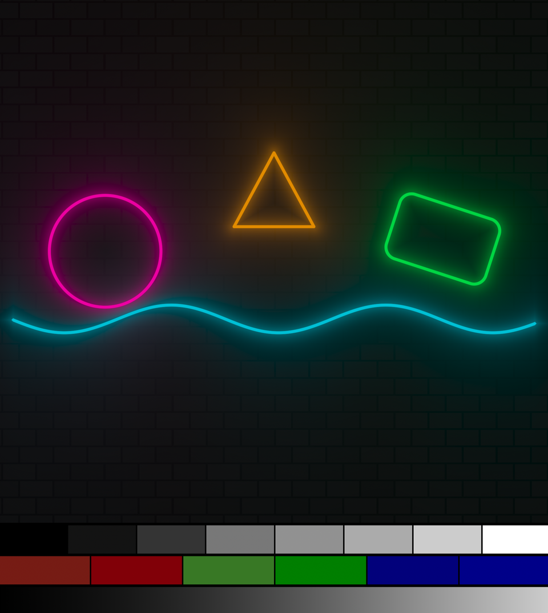

# hdrneon

Like glxgears, but for HDR.

    hdrneon                          # hdr10
    hdrneon --mode scrgb
    hdrneon --mode sdr --cycle 5     # sdr -> hdr10 -> scrgb every 5s
    hdrneon --cycle 2 --log m.jsonl  # each switch as a JSON line, timed

`hdrneon --help` for the rest. M or space switches mode, Q quits.

Only tested on Linux with AMD graphics (RADV).

## Prereqs

- Vulkan 1.3
- An HDR-capable display
- HDR support in your compositor, with HDR turned on

## Installing

On Linux, grab the release tarball, check it against its checksum, and put the binary in `~/.local/bin`:

    name=hdrneon-linux-$(uname -m)
    curl -fLO https://github.com/porkloin/hdrneon/releases/latest/download/$name.tar.gz
    curl -fLO https://github.com/porkloin/hdrneon/releases/latest/download/SHA256SUMS
    sha256sum -c --ignore-missing SHA256SUMS
    tar xzf $name.tar.gz
    install -Dm755 $name/hdrneon ~/.local/bin/hdrneon

Or with Homebrew:

    brew install porkloin/tap/hdrneon

Note: on older Linux distros where Homebrew uses its own glibc, it may not be able to load your GPU
driver. In that case, use a binary from the [releases page](https://github.com/porkloin/hdrneon/releases) instead.

## Analyzing output with the test strip

- Top: grey at 0, 1, 10, 100, 203, 400, 1000, 4000 nits.
- Middle: BT.709 vs BT.2020 red, green, blue, same brightness in each pair. The 2020 one should look more saturated.
  If they look the same, something's clipping to 709.
- Bottom: a 0-1000 nit ramp. Banding means something is dropping bits.

In HDR10 the top row's patches should come out as these 10-bit values:

| nits | full range | limited range |
|-----:|-----------:|--------------:|
| 0    | 0          | 64            |
| 1    | 153        | 195           |
| 10   | 307        | 327           |
| 100  | 520        | 509           |
| 203  | 594        | 573           |
| 400  | 668        | 636           |
| 1000 | 769        | 723           |
| 4000 | 923        | 855           |

## Building

    cargo build --release

The shaders are prebuilt in `shaders/`. If you change one, run `shaders/build.sh` (needs glslc).

GPL-3.0
